<h3><code>fog@github ~ $ ./contributions.sh</code></h3>

  

<h3><code>fog@github ~ $ whoami</code></h3>

<table>
  <tr>
    <td valign="top"></td>
    <td valign="top"></td>
  </tr>
</table>

 

<h3><code>fog@github ~ $ ls projects/</code></h3>

<table>
  <tr>
    <td><b><a href="https://github.com/arbac-hq">Arbac</a></b></td>
    <td>studio building agentic products</td>
  </tr>
  <tr>
    <td><b>Rubly</b></td>
    <td>always-on AI agent that runs marketing for small and medium businesses · <i>building now</i></td>
  </tr>
</table>

 

<h3><code>fog@github ~ $ ./contact.sh</code></h3>

  

Art regenerates daily via GitHub Actions · no tokens, no JS — animation lives inside the SVGs.

